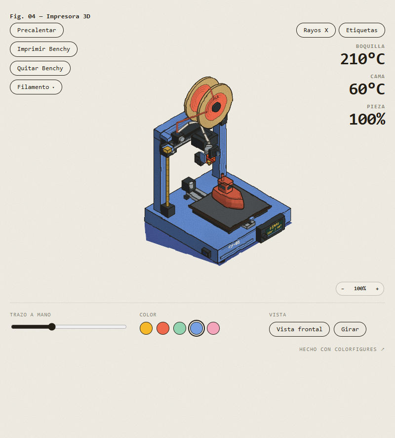
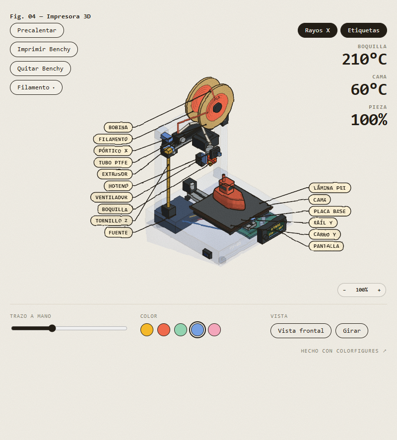

# Impresora 3D · Benchy

[](https://github.com/JesusGLDEVF/impresora-3d-benchy/actions/workflows/ci.yml)
[](https://jesusgldevf.github.io/impresora-3d-benchy/)
[](LICENSE)

Una figura isométrica interactiva, dibujada a mano, de una impresora 3D estilo bedslinger que imprime un Benchy capa a capa. Todo vive en un único HTML autocontenido: sin frameworks, sin dependencias y sin peticiones externas.

**Demo en vivo:** https://jesusgldevf.github.io/impresora-3d-benchy/  
**Vista de rayos X con etiquetas:** https://jesusgldevf.github.io/impresora-3d-benchy/?xr=1&labels=1

| Carcasa cerrada | Rayos X con etiquetas |
|:---:|:---:|
|  |  |

## La figura

- **Benchy por capas:** casco, cubierta, caseta, ventanas y chimenea; crece capa a capa hasta completar la pieza.
- **Mecánica de bedslinger:** la cama se desliza en el eje Y de la impresora, el pórtico sube en Z y el carro se mueve en X.
- **Circuito del filamento:** bobina, hilo, tubo Bowden, extrusor, hotend y boquilla; el ventilador y el bloque caliente forman parte del carro.
- **Rayos X real:** la carcasa se vuelve fantasma y aparecen la fuente, la placa base, el cableado, los motores, las correas y el husillo.
- **16 etiquetas** conectadas a las piezas, que se pueden ocultar.
- **Cámara libre:** giro de 360°, zoom, vista frontal, plato giratorio y trazo a mano ajustable.
- **Color de máquina y color de filamento independientes**, con la cara de la bobina mostrando el filamento cargado.
- **Funciona en móvil** y en cualquier navegador moderno.

## Controles

| Acción | Cómo |
|---|---|
| Calentar boquilla y cama | **Precalentar** |
| Imprimir el Benchy | **Imprimir Benchy** o `Espacio` |
| Retirar el Benchy | **Quitar Benchy** o `R` |
| Cambiar de filamento | **Filamento** o clic en la bobina |
| Ver el mecanismo | **Rayos X** |
| Mostrar u ocultar etiquetas | **Etiquetas** |
| Girar la figura | Arrastrar |
| Acercar o alejar | Botones **−** / **+** |
| Volver a la vista frontal | **Vista frontal** |
| Giro automático | **Girar** |
| Cambiar el color de la máquina | Círculos de **Color** |
| Suavizar el trazo | Deslizador **Trazo a mano** |

Al imprimir en frío, la figura precalienta automáticamente. La boquilla sube con cada capa y la cama se mueve bajo el hotend. Al terminar, el pórtico se aparca y el Benchy se puede retirar para empezar otra impresión.

## Cómo funciona

La escena está dibujada en un espacio isométrico con proyección ortográfica. Cada pieza se construye con cajas, cilindros y anillos de polígonos; las caras se sombrean con tres tonos planos y se rematan con una silueta de tinta. El Benchy se genera mediante `loft` entre anillos de capas, añadiendo una banda de color y una línea de tinta por capa.

- La **cama** es una plataforma sólida sobre un carro que se desplaza en X.
- El **pórtico** es una viga en Y sobre dos columnas; su altura sigue a la pieza impresa.
- El **carro X** lleva el extrusor, el hotend, el ventilador y la boquilla.
- La **bobina** alimenta el tubo PTFE; el color elegido se guarda para la siguiente impresión.
- En **rayos X**, los grupos de la carcasa se dibujan con opacidad reducida y los mecanismos quedan delante.

## Desarrollo local

No hay dependencias ni proceso de compilación para ver la demo.

```bash
git clone https://github.com/JesusGLDEVF/impresora-3d-benchy.git
cd impresora-3d-benchy
npm start
```

Abre **http://localhost:8100**. También puedes abrir `index.html` directamente en el navegador.

Para validar que la página sigue siendo autocontenida:

```bash
npm run check
```

## Estructura

```text
index.html                    Versión final autocontenida (la que se publica)
impresora.html                Fuente editable de la escena (usa core.js)
core.js                       Motor de dibujo Colorfigures
server.js                     Servidor local sin dependencias
tools/check.js                Comprobación de autocontención
.github/workflows/ci.yml      Integración continua
docs/                         Capturas para la documentación
```

La versión de distribución se generó con el script `build.py` de Colorfigures, que inserta `core.js`, añade el zoom y adapta las etiquetas al móvil. El resultado ya está incluido en `index.html`; `impresora.html` queda como fuente para seguir editando la figura.

## Créditos

- **Colorfigures** — colour, hand-drawn style, 3D props, template and examples, by [April Zhu](https://april-zhu.com/colorfigures) (MIT).
- **ISO-GLOW**, by April Zhu (MIT).
- **iso-figure**, by [Tolga Cohce](https://github.com/MrBongoC/ai-iso-skill) (MIT).
- Escena, animación e interacciones de la impresora: **Jesús GL**.

La figura es una pieza original construida sobre el motor y la plantilla de Colorfigures. `core.js` conserva los avisos de copyright originales.

## Licencia

MIT. Consulta [LICENSE](LICENSE).
